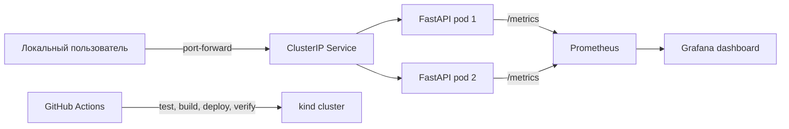

# ChronoRec Kubernetes Infrastructure Lab

Отдельный учебный репозиторий для практики контейнеров, Kubernetes, Helm,
GitHub Actions и наблюдаемости на примере **синтетического** ChronoRec API.

> Это не backend реального ChronoRec/MinFri и не хранилище пользовательских
> данных. Здесь нет настоящих голосовых записей, медицинских сведений или
> персональных данных. Все примеры придуманы специально для лаборатории.

## Что уже создано

- минимальный read-only FastAPI backend с `/healthz`, `/readyz`, `/metrics`;
- безопасный Dockerfile: непривилегированный пользователь и небольшой образ;
- локальный двухузловой kind-кластер;
- Helm chart с двумя репликами, probes, resource limits, PDB и NetworkPolicy;
- CI: lint, тесты, сборка образа и реальный smoke test в kind;
- Prometheus, Grafana и готовый dashboard;
- воспроизводимые сценарии Pod deletion, failed readiness rollout,
  CrashLoopBackOff и OOMKilled.

Текущий протокол проверок находится в [docs/VERIFICATION.md](docs/VERIFICATION.md).

## Архитектура



Подробные решения и границы проекта: [docs/ARCHITECTURE.md](docs/ARCHITECTURE.md).

## Быстрый старт на этом Mac

Первичная проверка 11 ноября 2026 года обнаружила macOS на Apple Silicon,
выключенный Docker Desktop и отсутствие `kind`/Helm. В ходе настройки Docker был
запущен, `kind` 0.33.0 и Helm 4.3.1 установлены, а весь локальный путь до Grafana
и четырёх failure-сценариев проверен. Детали — в протоколе проверок.

1. На новой машине установить инструменты и запустить Docker Desktop по инструкции
   [docs/SETUP_MAC.md](docs/SETUP_MAC.md).
2. Проверить среду:

   ```bash
   ./scripts/check-environment.sh
   ```

3. Создать кластер, собрать образ, развернуть Helm chart и выполнить smoke test:

   ```bash
   ./scripts/bootstrap-lab.sh
   ```

4. Открыть API в отдельном окне терминала:

   ```bash
   kubectl -n chronorec-lab port-forward service/chronorec-demo 8000:80
   ```

   Затем открыть <http://localhost:8000/docs> или выполнить:

   ```bash
   curl http://localhost:8000/api/v1/summary
   ```

5. Установить мониторинг:

   ```bash
   ./scripts/install-monitoring.sh
   ```

   Доступ к Grafana описан в [docs/MONITORING.md](docs/MONITORING.md).

6. После практики удалить только учебный кластер:

   ```bash
   kind delete cluster --name chronorec-lab
   ```

## Локальная разработка API без Kubernetes

```bash
make install-dev
make lint
make test
make run
```

Приложение будет доступно на <http://localhost:8000/docs>. Такой запуск полезен,
чтобы сначала понять API, а уже потом добавлять Docker и Kubernetes.

## Учебные сценарии отказов

Выполнять только в локальном кластере `chronorec-lab`:

1. удалить Pod и увидеть автоматическое восстановление;
2. выпустить неготовую версию и проверить автоматический Helm rollback;
3. создать CrashLoopBackOff и найти причину в логах;
4. вызвать OOMKilled, проверить лимит памяти и восстановить релиз.

Команды, ожидаемые симптомы и безопасное восстановление приведены в
[docs/runbooks/FAILURE_SCENARIOS.md](docs/runbooks/FAILURE_SCENARIOS.md).

## Структура репозитория

```text
app/                    FastAPI demo и Dockerfile
helm/chronorec-demo/    Helm chart
kind/                   конфигурация локального кластера
monitoring/             параметры Prometheus/Grafana
scripts/                проверка среды и воспроизводимые операции
tests/                  автоматические тесты API
docs/runbooks/           диагностика и восстановление после отказов
.github/workflows/      CI pipeline
```

## Честное описание для портфолио

Этот проект подтверждает практику с локальной учебной средой Kubernetes. Он не
должен описываться как опыт поддержки production-кластера. Добавлять в CV стоит
только те результаты, которые отмечены как проверенные в `docs/VERIFICATION.md`.
