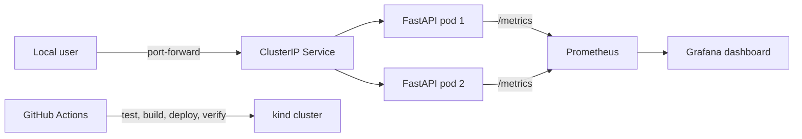

# ChronoRec Kubernetes Infrastructure Lab

A standalone learning repository for practising containers, Kubernetes, Helm,
GitHub Actions, and observability with a **synthetic** ChronoRec API.

> This is not the backend of the real ChronoRec/MinFri MVP and it is not a
> user-data store. It contains no real voice recordings, medical information,
> or personal data. Every example was invented specifically for this lab.

## What is included

- a minimal read-only FastAPI backend with `/healthz`, `/readyz`, and `/metrics`;
- a security-focused Dockerfile with a non-root user and a small base image;
- a local two-node kind cluster;
- a Helm chart with two replicas, probes, resource limits, a PDB, and a NetworkPolicy;
- CI for linting, tests, image builds, and a real smoke test in kind;
- Prometheus, Grafana, and a preconfigured dashboard;
- reproducible Pod deletion, failed readiness rollout, CrashLoopBackOff, and
  OOMKilled scenarios.

See [docs/VERIFICATION.md](docs/VERIFICATION.md) for the current verification record.

## Architecture



For design decisions and project boundaries, see
[docs/ARCHITECTURE.md](docs/ARCHITECTURE.md).

## Quick start on macOS

The initial environment check on 11 November 2026 found an Apple Silicon Mac,
Docker Desktop stopped, and `kind` and Helm missing. During setup, Docker was
started, kind 0.33.0 and Helm 4.3.1 were installed, and the complete local path
through Grafana and all four failure scenarios was verified. See the verification
record for details.

1. On a new machine, install the required tools and start Docker Desktop by
   following [docs/SETUP_MAC.md](docs/SETUP_MAC.md).

2. Check the environment:

   ```bash
   ./scripts/check-environment.sh
   ```

3. Create the cluster, build the image, deploy the Helm chart, and run the smoke test:

   ```bash
   ./scripts/bootstrap-lab.sh
   ```

4. Access the API from a separate terminal window:

   ```bash
   kubectl -n chronorec-lab port-forward service/chronorec-demo 8000:80
   ```

   Then open <http://localhost:8000/docs> or run:

   ```bash
   curl http://localhost:8000/api/v1/summary
   ```

5. Install monitoring:

   ```bash
   ./scripts/install-monitoring.sh
   ```

   Grafana access is documented in [docs/MONITORING.md](docs/MONITORING.md).

6. After the lab, delete only the training cluster:

   ```bash
   kind delete cluster --name chronorec-lab
   ```

## Local API development without Kubernetes

```bash
make install-dev
make lint
make test
make run
```

The application will be available at <http://localhost:8000/docs>. This mode is
useful for understanding the API before adding Docker and Kubernetes.

## Failure scenarios

Run these scenarios only in the local `chronorec-lab` cluster:

1. delete a Pod and observe automatic recovery;
2. release an unready version and verify the automatic Helm rollback;
3. create a CrashLoopBackOff and identify the cause in the logs;
4. trigger OOMKilled, inspect the memory limit, and restore the release.

Commands, expected symptoms, and safe recovery steps are provided in
[docs/runbooks/FAILURE_SCENARIOS.md](docs/runbooks/FAILURE_SCENARIOS.md).

## Repository structure

```text
app/                    FastAPI demo and Dockerfile
helm/chronorec-demo/    Helm chart
kind/                   Local cluster configuration
monitoring/             Prometheus and Grafana values
scripts/                Environment checks and reproducible operations
tests/                  Automated API tests
docs/runbooks/          Failure diagnosis and recovery procedures
.github/workflows/      CI pipeline
```

## Honest portfolio positioning

This project demonstrates hands-on work in a local Kubernetes learning
environment. It must not be presented as experience operating a production
cluster. Only results marked as verified in `docs/VERIFICATION.md` should be
included in a CV or discussed as completed work.
